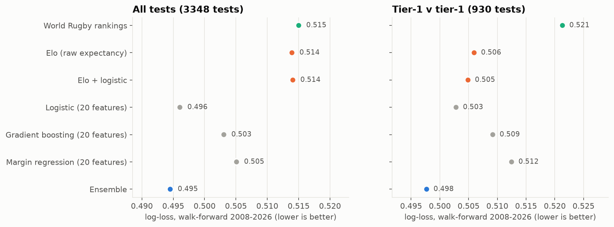
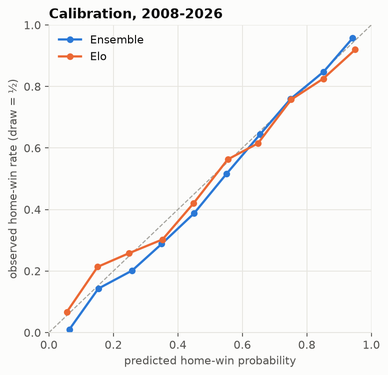
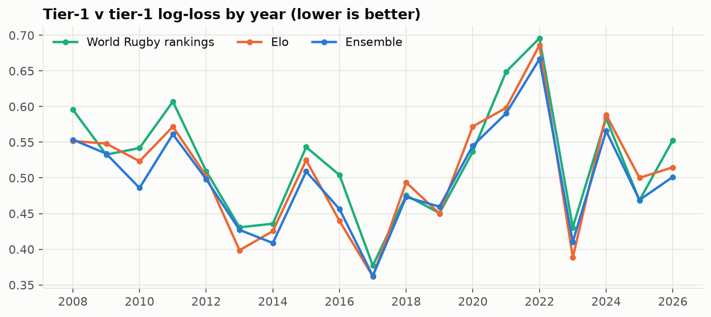
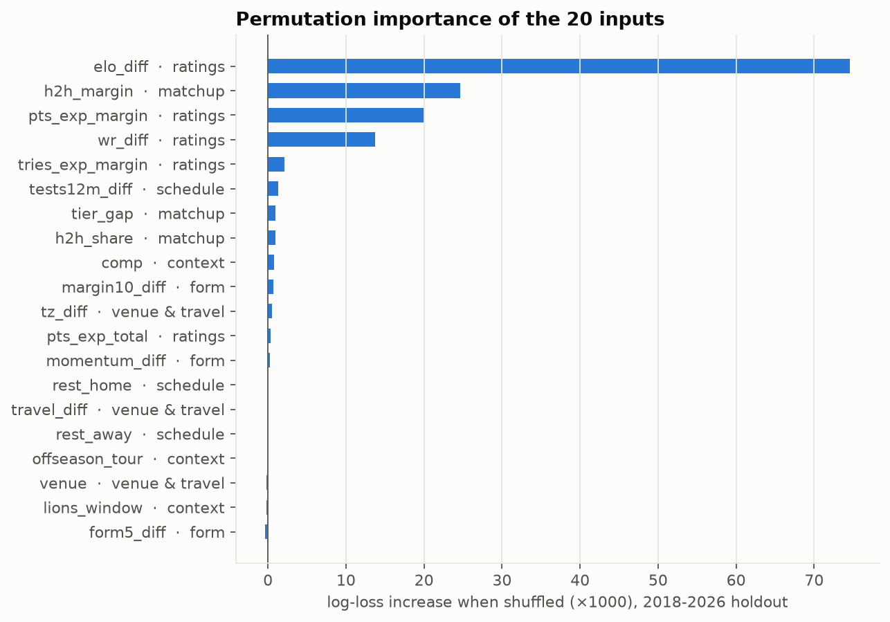
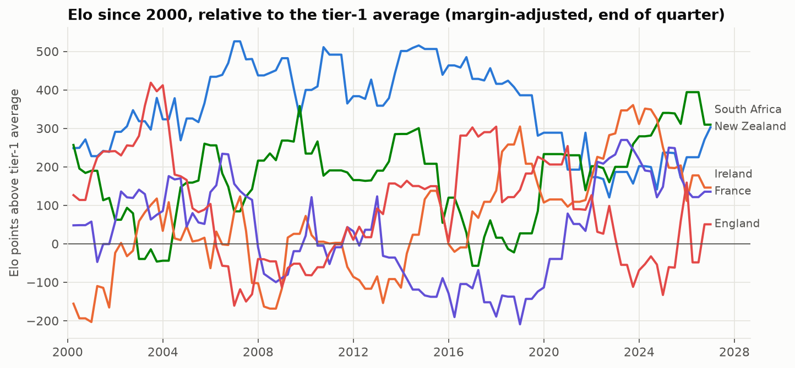
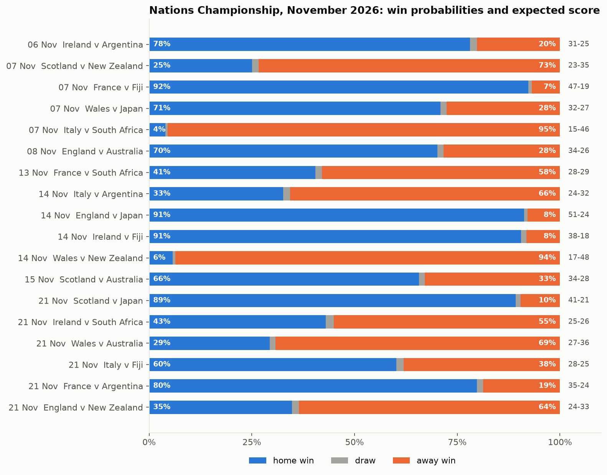

# Predicting Men's International Rugby Union Tests

Can 20 pre-match variables predict rugby tests better than the official World Rugby rankings
or a well-tuned Elo rating? This project builds a dataset of **7,538 men's tests (1871 to
24 Oct 2026)** from Wikipedia, engineers 20 features (ratings, form, rest, travel, time zones,
head-to-head, competition, Lions-tour windows and more), and tests four models **strictly
walk-forward**: every year from 2008 to 2026 is predicted by models trained only on earlier
years. It then prices the **November 2026 Nations Championship**.

The honest result: **ratings do most of the work, and the extra features add a real but
modest edge.** On the 2017-2026 holdout, the ensemble's log-loss is 0.490 against 0.505 for
Elo and 0.508 for the World Rugby rankings, and it is better calibrated. On tier-1 v tier-1
tests the gain shrinks (0.505 v 0.515), and the ensemble picks the winner barely more often than Elo (75.9% v 75.3%). Of the 20
inputs, four carry almost all the signal: Elo gap, recent head-to-head margin,
attack/defence expected margin and World Rugby points. Rest days, travel, form streaks and
the Lions window add essentially nothing once ratings are known.



## Key results

**Data.** 7,538 played tests and 147 scheduled fixtures, parsed from the `{{rugbybox}}`
match templates on 870 Wikipedia season pages (Six Nations, Rugby Championship, World Cups,
tours, mid-year and end-of-year windows, Pacific Nations Cup, Rugby Europe, Americas, Asia,
Africa and more). Tier-1 matches missing from Wikipedia's season pages, mostly before 2005,
are filled from Lyle Begbie's Kaggle dataset. *Validation:* of 1,396 tier-1 tests since 1995 in the Kaggle data, 1,294 match a
Wikipedia match within 3 days, and only 4 scores disagree. In at least two of those (the 1995
World Cup opener and Wembley 1999), Wikipedia is right and Kaggle is wrong. Home sides win
60.7% of tests since 2004; 2.0% are drawn.

| Timeline | Years | Used for |
|---|---|---|
| Burn-in | 1871 - 1994 | ratings only |
| Training start | 1995 (professional era) | every model is fitted on 1995 to the year before the test year |
| Selection window | 2008 - 2016 (1,596 tests) | choosing Elo K, home advantage, regularisation, tree depth, weights |
| **Holdout** | **2017 - Oct 2026 (1,752 tests)** | reported separately (see the note below) |

*A note on the holdout.* Elo's K and home advantage were tuned on 1995-2007, which is fully clean. The
model settings (regularisation, tree depth, sample weights, ensemble members) were chosen from about a
dozen variants. My experiments printed scores for the whole 2008-2026 period, so I saw the holdout
years while choosing. Each chosen setting was also the best (or tied) on 2008-2016 alone, and the
grid was small, so the optimism should be minor. Still, 2017-2026 is a near-clean holdout, not a
sealed one. The 2027 season will be the first truly out-of-sample test.

**1. Forecast accuracy (walk-forward, lower log-loss/Brier is better).** Draws count as half a win.

| Forecaster | Holdout log-loss | Holdout Brier | Holdout accuracy | Tier-1 holdout log-loss | Tier-1 holdout accuracy |
|---|---|---|---|---|---|
| Home-win base rate | 0.6746 | 0.2356 | 60.3% | 0.6825 | 58.9% |
| World Rugby rankings (logistic on the official gap) | 0.5077 | 0.1625 | 76.6% | 0.5219 | 75.1% |
| Elo, raw expectancy | 0.5055 | 0.1616 | 76.5% | 0.5153 | 75.3% |
| Elo + logistic | 0.5056 | 0.1620 | 76.5% | 0.5111 | 75.9% |
| Logistic, 20 features | 0.4954 | 0.1580 | 76.9% | 0.5114 | 75.5% |
| Gradient boosting, 20 features | 0.5005 | 0.1595 | 77.3% | 0.5182 | 76.2% |
| Margin regression, 20 features | 0.4976 | 0.1597 | 76.9% | 0.5116 | 74.4% |
| **Ensemble (average of the four)** | **0.4903** | **0.1568** | **77.4%** | **0.5045** | **75.9%** |

Over all 3,348 test-period matches (2008-2026), the ensemble scores 0.4945 against Elo's 0.5139.
On the 186 World Cup matches it scores 0.337 against Elo's 0.363 and World Rugby's 0.389.
Margin predictions miss by 11.2 points on average in tier-1 tests (15.3 across all tests).



The calibration plot shows where the gain comes from. Elo is **overconfident at the extremes**:
its 15% underdogs actually win about 21% of the time, and its 95% favourites win about 92% of the time. The
feature models learn how much to shrink a rating gap, so they sit on the diagonal.



Year-to-year noise is much larger than the gap between models. 2022, a year of upsets (Italy
beat Wales in Cardiff and Australia in Florence, Argentina won in Christchurch), was the hardest
year for every model. On tier-1 tests the ensemble beats Elo in 13 of the 19 years, not all of them.

**2. Which of the 20 variables matter?** Permutation importance: fit on 1995-2017, then
shuffle one feature at a time in 2018-2026 and measure how much worse the log-loss gets.



| Group | Features | Verdict |
|---|---|---|
| Ratings | Elo gap, World Rugby points gap, attack/defence expected margin, expected total, expected try margin | Nearly all the signal. Elo alone is worth 0.075 of log-loss. |
| Matchup | head-to-head margin (last 5), head-to-head win share (last 10), tier gap | **Head-to-head margin is the second most useful input.** Some matchups persist beyond what ratings capture. |
| Form | win rate last 5, margin last 10, Elo change over 12 months | Redundant once ratings are known. Ratings already *are* exponentially weighted form. |
| Schedule | rest days (each side), tests in last 12 months | Small. Activity helps a little for tier-2 sides with sparse fixtures. |
| Venue & travel | home/neutral/away, km travelled, time-zone shift | Home advantage is already inside the rating gaps (Elo's +120). Travel adds little on top. |
| Context | competition type, end-of-season tour, Lions-tour window | Competition type adds a little. The other two are near zero. |

Two findings that surprised me:
- **End-of-season tours don't hurt the tourists.** The `offseason_tour` coefficient says southern
  sides in November and northern sides in June slightly *beat* their ratings, not the other way
  round. One explanation is selection: touring squads pick fixtures they expect to win.
- **Lions years don't weaken the home nations' June tests measurably** once ratings are known.
  The sample is small (eight Lions summers since 1997).

The feature-group ablation (`python scripts/run_all.py --ablation`, results in
`figures/ablation.csv`) reruns the full walk-forward with each group removed:

| Group removed | Log-loss, all tests | Change | Log-loss, tier-1 v tier-1 | Change |
|---|---|---|---|---|
| (none, full model) | 0.4945 | | 0.4977 | |
| ratings* | 0.5058 | +0.0113 | 0.5057 | +0.0080 |
| matchup | 0.5030 | +0.0085 | 0.5004 | +0.0027 |
| context | 0.4947 | +0.0002 | 0.4980 | +0.0003 |
| form | 0.4948 | +0.0003 | 0.4946 | **−0.0031** |
| schedule | 0.4945 | 0.0000 | 0.4964 | −0.0013 |
| venue & travel | 0.4942 | −0.0003 | 0.4972 | −0.0005 |

\*The Elo + logistic member always keeps the Elo gap, so "ratings" measures what the other four
rating inputs add on top of Elo. Only ratings and matchup clearly earn their place. Removing
form actually *improves* tier-1 log-loss, which suggests a leaner 12-14 variable model would do
as well. I kept all 20 so the result is reported as specified, not tuned on the holdout.

**3. Current ratings (to 24 Oct 2026).** Elo top eight: South Africa, New Zealand, Ireland,
France, England, Scotland, Australia, Argentina. Then come Fiji and Georgia, both rated above
Wales, Italy and Japan. The reconstructed World Rugby points put New Zealand narrowly first
(77.2 v 76.6). The reconstruction runs the official formula from 1871 with seeded starting values,
so its scale is not the official one; its top eight are the same teams as Elo's.



**4. November 2026 Nations Championship.** The model fitted on every test to 24 Oct 2026:



The tightest games are France v South Africa (13 Nov, 41% / 58%), Ireland v South Africa
(21 Nov, 43% / 55%) and Italy v Fiji (21 Nov, 60% / 38%). South Africa and New Zealand are
favourites in every away match. Full numbers for all 147 fixtures, including the tier-2 Nations
Cup and Rugby Europe, are in `figures/upcoming_predictions.csv`.

## The maths in brief

**Elo with margin of victory.** R ← R + K·G·(S − E) with E = 1/(1 + 10^(−(R_h − R_a + H·v)/400)),
v ∈ {1, 0, −1} for home / neutral / away. The multiplier G = ln(|margin| + 1) · 2.2 / (0.001·d_w + 2.2),
where d_w is the winner's pre-match rating edge, damps big wins by heavy favourites
(FiveThirtyEight's autocorrelation fix). K = 36 and H = 120 were chosen on 1995-2007 log-loss.
Nations new to the system play their first 10 tests at double K.

**World Rugby rankings.** The official formula is a linear Elo with a cap:
gap D = R_h + 3·v − R_a, clipped to ±10; expected E = 0.5 + D/20; points exchanged
2(S − E), ×1.5 for a margin over 15 and ×2 at a World Cup. It ignores margins beyond 15 and
saturates at 10 points, which is why it trails Elo here.

**Attack/defence.** Expected points for = μ + attack_self − defence_opp ± home/2, updated
after each match by k·(actual − expected), with the surprise capped at ±40 points so tier-2
blowouts can't dominate. A second copy runs on tries wherever Wikipedia lists try scorers (43% of matches,
90% of them since 1990).

**Models.** Draws enter training as half a win and half a loss. Training rows are
weighted by recency (exp(−age/τ), τ = 8 years for the logistic, 12 for boosting) and tier-1 v tier-1
tests are up-weighted ×2-3, because tier-2 mismatches otherwise dominate the fit.
- *Logistic*: L2-regularised (C = 0.05) on 19 standardised numeric features + competition one-hot.
- *Gradient boosting*: 4-leaf trees, 400 rounds at learning rate 0.03. Deeper trees overfit.
- *Margin regression*: gradient-boosted median of the margin and mean of the total; the margin
  becomes win/draw/loss through a Normal whose spread is fitted to held-out residuals. Spread
  depends mostly on tier: about 15 points in tier-1 tests and 21 overall. Expected scoring barely moves it.
- *Ensemble*: a plain average of the three plus Elo + logistic. Adding Elo + logistic improved
  tier-1 log-loss in the selection window.

## How to run

```bash
uv venv --python 3.12 && uv pip install -e ".[test]"   # or: pip install numpy pandas scipy scikit-learn matplotlib requests pytest
python scripts/download_data.py      # optional: re-scrape Wikipedia (~25 MB); data/matches.csv is committed
pytest                               # 16 tests, about 2 seconds
python scripts/run_all.py            # every number and figure -> figures/ (~10 min)
python scripts/run_all.py --ablation # plus the feature-group ablation (~35 min)

python -m rugby.predict Ireland "South Africa" --date 2026-11-21 --comp nations_championship
python -m rugby.predict "New Zealand" Ireland --at USA          # neutral venue
python -m rugby.predict --fixtures --until 2026-11-30 --tier1   # every scheduled test
```

`rugby.predict` prints win/draw/loss, the expected margin and score, each model's view, and
the biggest drivers (the logistic part's log-odds contributions relative to an average test):

```
Sat 28 Nov 2026  Ireland v New Zealand (neutral, test)
  Ireland 29.0%   draw 2.0%   New Zealand 69.0%
  margin -6.4 (sd 19)   expected score 22-29
  models: Logistic 25.7%, Gradient boosting 25.9%, Margin regression 36.5%, Elo + logistic 31.8%, Elo 28.8%
  biggest drivers vs an average test (logistic part, log-odds, + favours home):
    elo_diff           -0.43   (value -156.98)
    pts_exp_margin     -0.41   (value -10.40)
    ...
```

## Project structure

```
rugby/
  data.py         parse {{rugbybox}} wikitext -> matches; dedupe across pages; Kaggle gap-fill;
                  learn each city's country to tell home from neutral venues
  teams.py        139 nations: codes, aliases, successor states, home coordinates
  ratings.py      margin-of-victory Elo, World Rugby formula, attack/defence (points and tries)
  features.py     the 20 pre-match features, one chronological pass, no look-ahead
  model.py        logistic, gradient boosting, margin model, ensemble, baselines
  evaluation.py   walk-forward backtest, log-loss / Brier / accuracy, calibration
  predict.py      CLI for fixtures and hypothetical matches
scripts/          download_data.py, run_all.py (every figure and number)
tests/            parser cases, ranking-formula examples, no-look-ahead, fixture isolation
```

Design choices worth knowing:
- **No look-ahead.** Each match's features are recorded *before* its result updates any state.
  A test changes every result after match k and checks that no feature up to match k moves.
  Scheduled fixtures get features but never update a rating.
- **Tuning and the holdout.** Settings were confirmed on 2008-2016 and the 2017-2026 numbers
  are reported separately. That period was visible during the experiments, though (see the note
  under the timeline), so treat it as near-clean.
- **Venue inference.** Wikipedia lists a "home" side even at neutral grounds. A city's
  country is learnt as the side that most often plays *home* tests there outside World Cups,
  with World Cup hosts and a short override list for neutral cities (Chicago, Tokyo, Hong Kong ...).

## Limitations

- **No line-ups, injuries or market prices.** These carry the information a bookmaker has and
  this model doesn't. The Odds API lists only the Six Nations for rugby union, so the
  2027 Six Nations is the first chance to test against a market (see
  [football-pricing-model](https://github.com/samberman-hi/football-pricing-model) for that method).
- Wikipedia coverage of tier-2 and tier-3 sides is thinner before about 2000. Their ratings
  are noisier, which partly explains why tier-2 margins are harder to call.
- Tier 1 here means the ten Six Nations and Rugby Championship sides. Fiji, Georgia and
  Japan now play at that level, and the ratings treat them that way; only the tier flag doesn't.

## Extensions

- **Bookmaker benchmark** for the 2027 Six Nations: closing-line value, as in the football project.
- **Squad strength**: caps and starts of the named XV, which matters most in Lions years and
  in World Cup warm-ups, when teams rotate.
- **Score simulation**: a bivariate model of tries, penalties and conversions, so tournament
  odds and bonus points (Six Nations table, World Cup pools) can be simulated.
- **2027 World Cup in Australia**: simulate the draw with this model.

*Data:* Wikipedia (CC BY-SA), via the MediaWiki API; L. Begbie, "International Rugby Union
Results from 1871-2024" (Kaggle), via a GitHub mirror. *References:* World Rugby, "World
Rugby Rankings explained"; N. Silver, "How We Calculate NFL Elo Ratings", FiveThirtyEight (2014),
for the margin multiplier.
